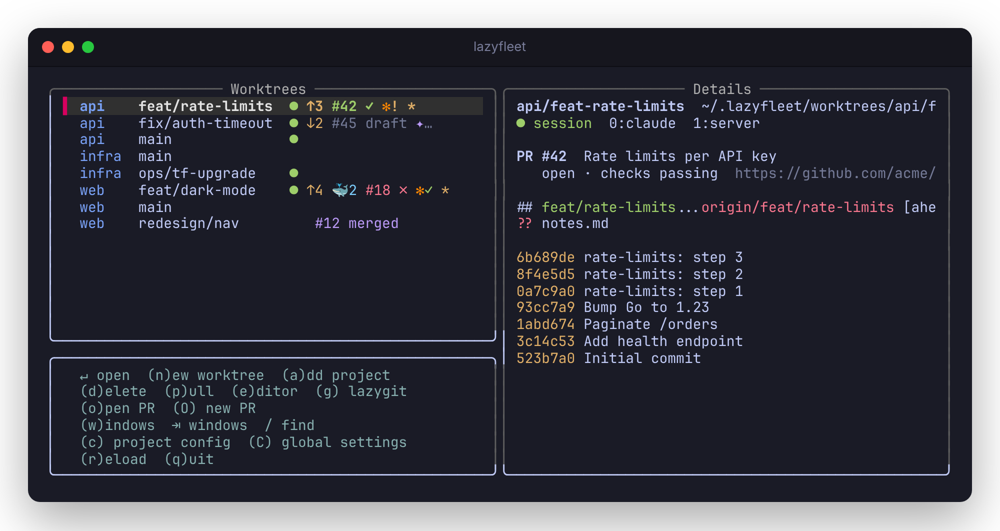

<h1 align="center">lazyfleet</h1>

<p align="center">
  <b>Every branch in its own worktree, every worktree in its own tmux session, all of them on one screen.</b>
</p>

<p align="center">
  <a href="https://github.com/mmolhoek/lazyfleet/actions/workflows/test.yml"></a>
  <a href="https://github.com/mmolhoek/lazyfleet/releases/latest"></a>
  <a href="LICENSE"></a>
  
</p>

<p align="center">
  
</p>

lazyfleet is a small, shell-only take on [Supacode](https://supacode.sh), driven from a lazygit-style TUI. Work on
five branches at once without stashing: each gets a [git worktree](https://git-scm.com/docs/git-worktree) and a tmux
session of its own, and lazyfleet shows them all, with what you need to know at a glance:

- **Where things stand.** A live session, commits ahead and behind, uncommitted changes, and the Docker containers
  each worktree started.
- **Pull requests and CI.** `#42 ✓` right on the row, refreshed in the background.
- **Coding agents.** [Claude Code](https://claude.com/claude-code), [GitHub Copilot CLI](https://github.com/features/copilot/cli)
  and [oh my pi](https://wener.me/notes/ai/agent/oh-my-pi) in any session, and whether one is waiting for you.
- **Clean-up.** `lazyfleet prune` removes the worktrees whose work has been merged, and nothing else.

It is pure zsh plus `git`, `tmux` and `fzf`: no daemon, no runtime, nothing to build.

## Quick start

```sh
curl -fsSL https://raw.githubusercontent.com/mmolhoek/lazyfleet/main/install.sh | sh
cd ~/src/my-project && lazyfleet add      # register a repo
lazyfleet new feat/login                  # a worktree + tmux session for a branch, and you are in it
lazyfleet                                 # the TUI: everything, at a glance
```

In the TUI, `enter` opens a worktree's session, `n` makes a new one, `tab` switches to every tmux window, and `q`
quits. You need `zsh`, `git`, `tmux` and fzf 0.66 or newer; `lazyfleet doctor` checks them all.

## Reading a row

| mark | means |
| --- | --- |
| `●` | the worktree has a live tmux session |
| `↑3 ↓2` | commits ahead of and behind its upstream |
| `*` (at the end) | uncommitted changes |
| `🐳2` | Docker containers started from it (compose working dir or devcontainer folder) |
| `⟳ pulling` | a background pull is running (`p`) |
| `#42 ✓` · `#42 ✗` · `#42 …` | its pull request, with CI passing, failing or running |
| `#42 draft` · `merged` · `closed` | a pull request in another state |
| `▲2/3` · `⟲` | second branch of a stack three high · it needs a restack (see [Stacked branches](#stacked-branches)) |
| `✻` · `✦` · `π` | Claude Code · Copilot CLI · oh my pi running in its session (`✻2` for two) |
| `✻!` · `✻✓` · `✻…` | an agent that waits for you · has finished · is working |

The Details pane on the right shows the session's windows, the containers, the pull request with its title and
checks, `git status` and the latest commits.

## The Windows view

`tab` (or `w`) lists every tmux window in every session, with a live preview of its screen. `enter` jumps there.
lazyfleet starts on this view when tmux has windows open.

Outside tmux, opening a worktree attaches to its session, and when you detach (`prefix d`) you are back in the TUI.
Inside tmux, it switches the client and the TUI closes. Bind it to a key for a switcher popup (with the full path:
tmux runs it with the PATH its server started with):

```tmux
bind w display-popup -E -w 80% -h 60% "~/.local/bin/lazyfleet"
bind W display-popup -E -w 80% -h 60% "~/.local/bin/lazyfleet windows"
```

## Agents

lazyfleet finds a running `claude`, `copilot` or `omp` below a tmux pane's shell, however it was started (the
native binary, the npm package under node or bun, `gh copilot`), and marks the worktree and the window it runs in.

What an agent is *doing* comes from hooks. `lazyfleet hooks install` adds them to Claude Code's
`~/.claude/settings.json` (or `$CLAUDE_CONFIG_DIR`); it needs `jq`, keeps your own settings and hooks, and saves the
original once as `settings.json.lazyfleet.bak`. `lazyfleet hooks uninstall` takes them out again, and
`lazyfleet hooks status` says whether they are in. Without hooks Claude Code still shows `…` while it works (lazyfleet
reads "esc to interrupt" off the screen). Any other agent can report the same way from inside its pane:

```sh
lazyfleet-hook <claude|copilot|omp> <working|waiting|done|idle|clear>
```

Finished work in a pane you are looking at counts as seen, so `✓` only stays on what you have not looked at.

**Know when you are needed.** Put the segment in your tmux status bar:

```tmux
set -g status-right '#(lazyfleet status) %H:%M'
```

It names the sessions whose agent waits for you (`! app`) or is done (`✓ api`), skipping what is on your screen.
When an agent starts waiting or finishes, sessions you are not in also get a short message (`✻ app needs you`);
`agent_notify=off` turns that off. tmux runs `#()` through `sh` with the PATH the tmux server started with, so use
the full path (`#(~/.local/bin/lazyfleet status)`) when `lazyfleet` is only on your shell's PATH. `lazyfleet doctor`
checks this for you.

## Pull requests and CI

With [`gh`](https://cli.github.com) logged in and a GitHub `origin`, each branch that has a pull request shows it on
its row. lazyfleet asks GitHub in the background, at most every 90 seconds and backing off when GitHub or the network
fails, so the list never waits for it. Checks are fetched for open pull requests only, at most 25 per repository.

From the TUI, `o` opens a worktree's pull request in the browser, and `O` opens GitHub's page for a new one
(lazyfleet itself creates nothing on GitHub). From the command line, `lazyfleet new --pr 123` makes a worktree of a
pull request's branch, and `lazyfleet new --issue 45` one on a branch named after an issue
(`issue-45-fix-the-login-page`). A pull request from a fork gets a local branch `pr-123`.

## Stacked branches

A big change reviews better as a chain of small branches, each built on the one below it: `fix/parser` on `main`,
`refactor/ast` on `fix/parser`, `feat/macros` on `refactor/ast`. lazyfleet keeps track of that chain with plain git;
no other tool is needed.

- **Start one:** `N` on a row (or `lazyfleet new <branch> --on <parent>`) makes a worktree whose branch starts from
  the row's branch and is stacked on it. `s` stacks an existing branch on another one, or unstacks it
  (`lazyfleet stack on <parent>` / `off`).
- **See it:** stacked rows show `▲2/3`, and the Details pane draws the whole stack. `⟲` means the branch's parent
  has moved on since the branch was based on it (an amended commit, a review fix, a pull of `main`).
- **Restack:** `S` (or `lazyfleet stack restack`) rebases every branch of the stack onto its parent, from the bottom
  up, each in its own worktree. A worktree with uncommitted changes stops it before anything is rebased.
- **Conflicts:** when a rebase stops on a conflict, lazyfleet opens [lazygit](https://github.com/jesseduffield/lazygit)
  in that worktree, when it is installed: resolve the conflicts there (pick hunks, or `e` for your editor), let it
  continue the rebase, and quit. lazyfleet then carries on with the rest of the stack. Quit with conflicts left and
  the rebase waits for you: the row shows the branch and `⟲`, and `S` opens lazygit again. Resolved but not
  continued, lazyfleet continues it; aborted in lazygit, the restack stops and the branch is as it was.
- **Without lazygit**, lazyfleet lists the files in conflict itself, each one's conflict in the preview. `e` (or
  `enter`) opens a file in `$VISUAL` / `$EDITOR`; once you save it without conflict markers it is marked resolved,
  and the list shows the files still in conflict. When none are left the rebase continues (it may stop again on a
  later commit). `a` aborts the rebase (it asks), `esc` leaves it for later.
- **Without a terminal** (a script), `restack` stops instead; resolve and `git add` the files, and `restack`
  continues the rebase.
- **Merging:** when the bottom branch is merged and deleted (by `lazyfleet prune`, say), the branch above it shows
  `⟲` with "parent gone"; restack moves it onto the default branch, keeping only its own commits, so squash merges
  work too.

lazyfleet only rebases when you ask (`S` or `restack`). The parent is kept in the repo's git config
(`branch.<name>.lazyfleetParent`), which git renames along with the branch and deletes along with it.

## Commands

```sh
lazyfleet                      the TUI
lazyfleet windows              the TUI on all tmux windows
lazyfleet add [path]           register a repo
lazyfleet forget [repo]        unregister a repo (its files are kept)
lazyfleet repos                list registered repos
lazyfleet ls                   list worktrees with their status
lazyfleet new <branch> [-r repo] [-b base | --on parent] [--no-open]
lazyfleet new --pr <number> | --issue <number> [-r repo] [-b base] [--no-open]
lazyfleet open [worktree]      attach to (or, inside tmux, switch to) a worktree's session
lazyfleet rm [worktree] [-f] [-D]
                               remove a worktree; -f: even if dirty, locked or with agents running,
                               -D: delete its local branch too
lazyfleet pull [worktree]      fast-forward to its upstream (git pull --ff-only)
lazyfleet stack [show | on <parent> | off | restack] [worktree]
                               show a stack, stack a branch on a parent, unstack it, or restack
lazyfleet prune [-n] [-y] [--keep-branches] [--no-fetch] [-r repo | --all]
                               remove the worktrees whose branch is merged
lazyfleet config [repo]        edit the settings, or a repo's own config, in $VISUAL / $EDITOR
lazyfleet status               tmux status segment for agents that need you
lazyfleet hooks [install|uninstall|status]
lazyfleet doctor               check that everything lazyfleet needs is there
lazyfleet update [--install]   look for a newer release now; --install installs it
lazyfleet version              show the installed version
```

A worktree can be named by its path, its branch (`feat/x`), its session (`app/feat-x`) or its directory name.
`new` reuses a local branch first, then `origin/<branch>`, and otherwise creates the branch from `-b base` (default
`origin/HEAD`, then `HEAD`). New worktrees go to `~/.lazyfleet/worktrees/<repo>/<branch, with / as ->` (see [Settings](#settings)).

<details>
<summary><b>Keys in the TUI</b></summary>

| key         | Worktrees view                                                     | Windows view       |
| ----------- | ------------------------------------------------------------------ | ------------------ |
| `enter`     | open session                                                       | switch to window   |
| `n`         | new worktree in this row's repo: pick a branch, or type a new name |                    |
| `d`         | remove worktree (asks; optionally deletes the branch); on a repo's main worktree it offers to forget the repo | kill window (asks) |
| `p`         | pull in the background (⟳ on its row); git's error if it fails     |                    |
| `e`         | open the worktree in `$VISUAL` / `$EDITOR` (a window named `edit`)  |                    |
| `g`         | open lazygit in the worktree (a window named `lazygit`)            |                    |
| `o`         | open the worktree's pull request in the browser                    |                    |
| `O`         | open GitHub's page for a new pull request                          |                    |
| `N`         | new worktree stacked on this row's branch                          |                    |
| `s` · `S`   | pick the branch this one is stacked on (or none) · restack its stack |                  |
| `a`         | add repo: pick one found under your project dirs, or type a path   | add repo           |
| `tab` · `w` | switch between Worktrees and Windows · Windows view                | back to Worktrees  |
| `c` · `C`   | edit the project config · the global settings                      | global settings    |
| `/` · `esc` | fuzzy filter (type a repo name to narrow the list) · leave filter  |                    |
| `r` · `q`   | reload · quit                                                      |                    |

`e` and `g` start the tool in a window of the worktree's own session (creating the session when needed) and switch
to it; pressing the key again shows that window instead of starting a second one. `o` uses the pull request data
lazyfleet already has, so it works a moment after the marks appear; it uses `$BROWSER`, else `open` (macOS) or
`xdg-open`, and only ever opens `https://github.com/<owner>/<repo>/pull/<number>` links. `O` needs the branch on
`origin` first (`git push -u origin <branch>`) and refuses the default branch; choose "Create draft pull request" in
GitHub's button menu for a draft.

In the `n` and `a` pickers, `enter` takes the highlighted entry, or what you typed when nothing matches; `ctrl-n`
always takes what you typed. All lists are sorted alphabetically.

</details>

## Setting up a repo: `.lazyfleet`

Put a `.lazyfleet` in the repo root to prepare every new worktree: files to copy in, and a command to run.

```
copy=.env .env.local
setup=
  npm ci
  docker compose up -d db
  npm run migrate
```

- `copy`: untracked files copied from the main worktree (paths inside the repo: no leading `/`, no `..`).
- `setup`: runs in the first window of the new worktree's session, through your interactive shell, so mise, direnv
  and aliases work. Questions your shell asks on entering the directory (a mise enter hook) come first and wait for
  you; then the window stays open as a normal shell. Under fish it runs as a `/bin/sh` child of fish.

A value continues on indented lines; the first one's indent is removed from all, so nested blocks keep their shape.
The file is read as data and never sourced, but `setup=` does run on your machine. That is why a branch's own
`.lazyfleet` (think `new --pr`) only counts when it says the same as the main worktree's; otherwise it is skipped and
the summary says so (`trust_branch_config=on` runs it anyway).

**Without committing anything,** give the repo a file of your own, `~/.config/lazyfleet/projects/<repo>.conf`, with
the same keys. It wins over `.lazyfleet`. Press `c` on a row (or run `lazyfleet config <repo>`) to edit it; a new one
starts from a template that shows the repo's `.lazyfleet` too. (`[repo]` sections in `~/.config/lazyfleet/config`,
the older layout, still work, between the two.)

## Settings

Global settings live in `~/.config/lazyfleet/config` (`C` in the TUI, or `lazyfleet config`), one `key=value` per
line. The environment variable under each name wins when it is set.

| setting | what it does | default |
| --- | --- | --- |
| `search`<br><sub>`LAZYFLEET_SEARCH`</sub> | where `a` looks for repos (space-separated dirs) | the first of `~/Projects`, `~/code`, `~/src`, `~/dev`, `~/work`, `~/git`, `~/repos`, `~/workspace` that exist, else `~` |
| `search_depth`<br><sub>`LAZYFLEET_SEARCH_DEPTH`</sub> | how deep `a` looks | `4` |
| `worktrees`<br><sub>`LAZYFLEET_WORKTREES`</sub> | where new worktrees go | `~/.lazyfleet/worktrees` |
| `status_branch`<br><sub>`LAZYFLEET_STATUS_BRANCH`</sub> | `off`: no branch in the sessions' status bar | `on` |
| `update_check`<br><sub>`LAZYFLEET_UPDATE_CHECK`</sub> | `off`: no daily check for a new release | `on` |
| `agent_icons`<br><sub>`LAZYFLEET_AGENT_ICONS`</sub> | `off`: no `✻` `✦` `π` agent marks | `on` |
| `agent_notify`<br><sub>`LAZYFLEET_AGENT_NOTIFY`</sub> | `off`: no tmux message when an agent needs you or is done | `on` |
| `pr_status`<br><sub>`LAZYFLEET_PR_STATUS`</sub> | `off`: no `#42 ✓` pull request and CI marks | `on` |
| `trust_branch_config`<br><sub>`LAZYFLEET_TRUST_BRANCH_CONFIG`</sub> | `on`: run a branch's own `setup=`/`copy=` even when it differs from the main worktree's | `off` |

```
search=~/Projects ~/work
search_depth=3
```

## Pruning merged worktrees

`lazyfleet prune` removes the worktrees, and their local branches unless you pass `--keep-branches`, whose work is
merged. Only two things count as merged:

- GitHub says the branch's pull request was merged, **and** the worktree is at the commit it ended with (so squash
  merges work, and anything you did afterwards keeps the worktree);
- the branch's remote branch is gone and all its commits are in the default branch.

A merged worktree with uncommitted changes, a lock, or agents running is listed as `keep`, with the reason, and left
alone; the main worktree is never touched. It runs `git fetch --prune` first (`--no-fetch` skips it), shows what it
would remove and asks. `-n` only lists, `-y` does not ask (needed without a terminal). It works on the repo you are
in, on `-r <repo>`, or on `--all`.

`rm` asks too, when the worktree has changes or agents running in its session (removing the worktree closes the
session and ends them); `-f` skips the questions. The TUI's `d` also offers to stop the worktree's containers.

## Install

The install script puts lazyfleet in `~/.local/share/lazyfleet` and links `~/.local/bin/lazyfleet`. It never edits
your rc files; it tells you what to add.

```sh
curl -fsSL https://raw.githubusercontent.com/mmolhoek/lazyfleet/main/install.sh | sh
```

Run it again to update, or add `-s -- uninstall` after `sh` to remove lazyfleet.

`LAZYFLEET_VERSION=v1.2.3` pins a release (with `LAZYFLEET_SHA256` to verify the download), or names a branch such as
`main` to try unreleased work. `LAZYFLEET_INSTALL_DIR` and `LAZYFLEET_BIN_DIR` change the locations.

<details>
<summary><b>From a checkout</b></summary>

lazyfleet is zsh, so zsh must be installed (it is on macOS), but it does not have to be your shell:

```sh
# ~/.zshrc (the command, with completion)
source /path/to/lazyfleet/lazyfleet.zsh
# ~/.bashrc (the command)
export PATH="/path/to/lazyfleet/bin:$PATH"
# ~/.config/fish/config.fish
fish_add_path /path/to/lazyfleet/bin
```

For a shorter command, add `alias lzs=lazyfleet`.

</details>

<details>
<summary><b>Updates</b></summary>

An install from the script looks for a newer release once a day, in the background (one request to github.com,
carrying no data from lazyfleet). When there is one, the TUI's title says `lazyfleet · v1.2.3 available`, and quitting
tells you how to update (inside tmux, as a tmux message). `lazyfleet update` looks right now, and
`lazyfleet update --install` installs what it finds. `lazyfleet doctor` says when the check last looked. The version
is on the last line of the TUI's key help, at the top of `lazyfleet help`, and in `lazyfleet version`. A checkout,
or an install of a branch, never checks. `update_check=off` turns the check off.

</details>

<details>
<summary><b>When something does not work: <code>lazyfleet doctor</code></b></summary>

`lazyfleet doctor` checks the machine and suggests a fix for each problem. Each finding is `ok`, `warn` (a feature is
reduced, or may not work) or `FAIL` (lazyfleet cannot work):

- `zsh`, `git`, `tmux` and `fzf` are installed and recent enough (fzf 0.66 or newer; an older zsh, git or tmux only
  warns);
- `curl` (update check), `gh` with a login (pull request marks), and, when `claude` is installed, `jq` and the
  Claude Code hooks;
- this install's version, and what the update check last found;
- the agent segment in tmux's status line, when there is one, and whether tmux can find `lazyfleet`;
- registered repositories whose directory is gone.

It exits with status 1 when anything failed, so scripts can use it.

</details>

<details>
<summary><b>What lazyfleet keeps where</b></summary>

- Registry: `~/.config/lazyfleet/repos`, one path per line.
- Settings: `~/.config/lazyfleet/config`; per repo: `~/.config/lazyfleet/projects/<repo>.conf`.
- Sessions are named `<repo>` for the main worktree and `<repo>/<worktree-dir>` for the others. The sessions
  lazyfleet starts show the branch of the active pane at the start of their `status-right` (followed by your global
  one, as it was when the session started), following checkouts within `status-interval`.
- Agent state: one small file per agent and pane in `~/.cache/lazyfleet/agents` (`LAZYFLEET_AGENT_DIR` moves it),
  removed when the agent stops.
- Pull request cache: one small file per repository in lazyfleet's temporary directory (`pr/`), safe to delete.
- `LAZYFLEET_TMUX` overrides the tmux command (e.g. `tmux -L other`).

</details>

## Contributing

Bug reports and pull requests are welcome. [CONTRIBUTING.md](CONTRIBUTING.md) explains how the code is laid out, the
conventions it follows, and how to run the 17 test suites.

## License

[MIT](LICENSE)
